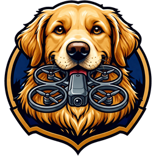

<p align="center"></p>

<h1 align="center">DroneDog</h1>

<p align="center">Drone flight-log forensics for Windows. Portable, offline, read-only on evidence.</p>

---

> **Training and research tool. Not independently validated for casework.**
> DroneDog has not been tested by a third party, peer reviewed, or subjected to an error-rate study. If you consider it for a real case, validate it under your laboratory's procedures and verify every finding with an independent, validated tool. What has and has not been tested: [docs/VALIDATION_STATUS.md](docs/VALIDATION_STATUS.md). Provided under the [PolyForm Noncommercial License 1.0.0](LICENSE), for noncommercial use only, without warranty of any kind.

DroneDog takes DJI flight-log evidence from start to finish: disk images, SD cards, phone backups or loose logs go in, and a hashed, printable examination report comes out. It finds every flight-log artifact, including deleted ones, and decodes it. It then classifies each record, maps and replays each flight and links aircraft logs to the phone logs of the same flight. Every step is written to a hash-chained custody log.

No other forensic tool is needed: DroneDog does not depend on FTK Imager, DatCon, CsvView or a separate log parser. It makes no network calls unless the examiner turns on online maps.

## Contents

- [Download](#download)
- [Supported evidence](#supported-evidence)
- [What it produces](#what-it-produces)
- [Evidence handling](#evidence-handling)
- [Validation](#validation)
- [Limitations](#limitations)
- [Scope boundaries](#scope-boundaries)
- [Building from source](#building-from-source)
- [Command line](#command-line)
- [Repository layout](#repository-layout)
- [Documentation](#documentation)
- [Third-party software and data](#third-party-software-and-data)
- [License](#license)

## Download

Download `DroneDog-portable.zip` from [Releases](../../releases), check it against the published SHA-256, unzip it, and run `DroneDog.exe`. Nothing is installed.

- Requires Windows 10 or 11 with the Microsoft Edge WebView2 runtime (built into Windows 11).
- Cases are saved in a `Cases` folder next to `DroneDog.exe` unless another location is chosen. App settings are kept in `DroneDogData` beside the exe.
- Use an exFAT or NTFS drive if evidence files larger than 4 GB will be copied into a case.

**Workflow:** New case → Add evidence (E01, raw image, DAT, TXT, zip or folder) → Import → Flights → open a flight → Summary tab → Report.

## Supported evidence

| Input | Handling |
|---|---|
| E01 / Ex01 segment sets | Read via libewf. The media hash is checked against the hash stored in the E01. |
| Raw images (`.dd`, `.img`, `.bin`, split `.001/.002…`, whole-device `mmcblk` dumps) | Volumes and file systems (FAT, exFAT, NTFS, ext) walked with The Sleuth Kit, including deleted entries |
| Mounted SD cards, drive letters, raw devices (`\\.\PhysicalDrive1`, administrator) | Walked in place |
| Folders, zip archives and tar / tar.gz archives (nested) | Walked recursively. Tars are read as a stream; a truncated tar keeps every file read before the break and records where it stopped |
| iOS backups (folder or zipped; `Manifest.db` or `Manifest.mbdb`) | Files mapped back to their app paths |
| Android logical extractions, including "quick image" zips holding `sdcard.tar.gz` and `adb-data.tar` | Walked recursively; DJI GO / Fly / Pilot app folders recognised |
| DJI Assistant `.DAT` export bundles | Split into their individual logs |
| DJI aircraft `FLYxxx.DAT` (plaintext) | Decoded by DroneDog's own DAT decoder (record CRC-16 checked) |
| DJI `MISC/LOG/flylog/fc_log.log` ring log (e.g. Mavic Mini SD card) | Split into its logs by the file's own index (the log that wraps around the end of the ring is rejoined); each log is decoded as a DAT. A log whose start was overwritten by later logs is reported with its surviving byte range, not extracted |
| DJI app flight records `DJIFlightRecord_*.txt` (DJI GO, GO 4, Fly, Pilot) | Decoded with dji-log-parser, offline |

If you add a folder that holds a device extraction, each image, zip and iOS backup inside it becomes its own evidence item.

## What it produces

**Per flight record**

- Classification with its basis stated: flight; GPS movement recorded without in-air state (no in-air, motor-running or height values in the log, GPS position moved at least 50 m); motor start recorded without in-air state; no motor start or in-air state recorded; text log only; encrypted (header only); no decodable data. A record is classified as a flight when the flight controller reported the in-air state for at least 2 s. When that state is never reported, the rule is motors on with more than 1 m of height gain for at least 2 s; when no motor-running state is recorded either, height gain of more than 2 m for at least 5 s. Height before the first GPS fix is not used and not plotted, because it is not referenced to the takeoff point.
- The Flights list separates records with a GPS track from records without one.
- Takeoff, landing and home point: UTC time, WGS 84 coordinates, and the nearest named place from an offline GeoNames gazetteer. The home-point history and return-to-home / auto-landing periods are included.
- Statistics: air time, distance, maximum height, maximum horizontal and vertical speed, maximum distance from home, battery, GPS fixes and flight modes.
- Identifiers, each with its source line or field: aircraft, flight controller, battery, camera, remote controller, ESC and navigation serials and firmware versions.
- A timeline of key moments, and the flight-controller event log with explanations. The original log text is always shown next to each explanation.
- Map playback with synchronized charts (altitude, speed, battery, RC sticks, GPS).

**Across a case**

- Correlation between aircraft logs and app logs of the same flight, with the reasons listed (serial match, home-point distance, matched frame pairs). Rejected candidates are kept and can be displayed.
- Exports: JSON, GeoJSON, KML and a self-contained printable HTML report with embedded maps. Each export folder includes a `manifest.sha256` and is set read-only.

## Evidence handling

- Evidence is never modified. Loose files and zips up to 4 GiB are copied into the case, hashed (SHA-256, SHA-1, MD5) while copying, re-read and verified, then set read-only. Disk images are referenced in place and hashed.
- Imager sidecar hashes (`.md5`, `.sha1`, `.txt`) next to an image are compared automatically.
- Every extracted artifact is stored once per unique SHA-256, with each place it was found recorded: evidence item, partition, inner path and byte offset.
- Deleted files are included where The Sleuth Kit exposes them. They are flagged, and on FAT file systems a cluster-overwrite check is recorded.
- The custody log is hash-chained JSONL. `python -m dronedog custody verify <case>` reports the first altered line.
- Online maps are off by default. When they are on, only map tiles are requested, and the network indicator shows hosts, purposes, bytes and the app's OS-level sockets.

## Validation

The 2026-10-22 run imported 20 inputs through the production pipeline, each into a fresh case. Inputs came from NIST CFReDS / VTO Labs drone images, DataverseNO doi:10.18710/AFDYLS (CC0), and public samples.

| Flight-log artifacts | Parsed | Encrypted (header only) | Failed | Flight records | Classified as flights (all with GPS track) | Custody chain |
|---|---|---|---|---|---|---|
| 320 | 241 | 73 | 0 | 314 | 96 | verified for every case |

The DAT decoder is checked against DatCon output on public datasets. Golden baselines are in `corpus/baselines/`. Per-input results are in [docs/VALIDATION_RUN.md](docs/VALIDATION_RUN.md).

## Limitations

- **Encrypted aircraft DATs** (Mavic Air / 2, Mini, Air 2 and later): recognised and reported as encrypted, attribution from the header only.
- **App TXT v13 / v14:** the plaintext header, serials and totals are read. Flight records require a DJI keychain, which is not obtained by DroneDog.
- **V1-era Agras MG-1S / A3 DATs:** events, timing and serials only. No position track, because no record layout is published.
- **Autel, Parrot, Skydio:** not supported.
- Place names are the nearest named populated place, not postal addresses or boundary determinations.

[docs/ENCRYPTED_CAPABILITIES.md](docs/ENCRYPTED_CAPABILITIES.md) sets out each gap and the technical, legal and validation work required to close it.

## Scope boundaries

DroneDog does not break ciphers, extract or derive keys, or exploit devices. It operates only on artifacts that are already lawfully readable:

- plaintext logs;
- output of an official tool;
- a published decryptor licensed for this use;
- DJI's keychain service with a valid key.

Device access (chip-off, ISP, bootloader exploits) is outside this project. DroneDog reads the image produced by that process.

## Building from source

Requirements: Windows, Python 3.13, Rust stable (MSVC toolchain).

```powershell
python -m venv .venv
.venv\Scripts\pip install -r requirements.txt

# build the Rust core (dronedog_core) into the venv
.venv\Scripts\maturin develop -m core\Cargo.toml --release

# run the desktop app
.venv\Scripts\python -m dronedog.ui

# tests
.venv\Scripts\python -m pytest tests
cd core; cargo test --release --no-default-features

# portable build -> release\DroneDog\ and release\DroneDog-portable.zip (+ .sha256)
.venv\Scripts\python tools\make_release.py --no-kit
```

Corpus tests look under `corpus/raw`, `corpus/_downloads` and `corpus/samples` (override with `DRONEDOG_CORPUS`) and skip when no samples are present. Test evidence is not included in this repository. `tools/cfreds_fetch.py` downloads the CFReDS images.

## Command line

```text
python -m dronedog case new  <dir> --name "Case name" --examiner "Examiner" [--case-number N] [--agency A]
python -m dronedog case add  <dir> <paths...> [--run] [--copy | --reference]
python -m dronedog case run  <dir> [--retry-failed]
python -m dronedog case info <dir> [--json]
python -m dronedog custody verify <dir>
python -m dronedog scan <paths...>            # list flight-log candidates without creating a case
```

## Repository layout

```text
core/        Rust crate dronedog_core (PyO3): format detection, DAT and TXT decoding
dronedog/    Python application
  case/        case model, SQLite store, hashing, custody log
  ingest/      evidence sources: images, folders, zips, iOS backups, file-system walking
  adapters/    parser adapters over dronedog_core
  analysis/    flight classification, correlation, event explanations, offline geocoding
  report/      HTML report and static maps
  ui/          pywebview desktop host and the vendored, offline web UI
packaging/   PyInstaller spec and launcher
tools/       build-time scripts (corpus download, validation run, release)
tests/       pytest suite
docs/        format notes, event glossary, validation run, capability notes
corpus/      validation baselines (test evidence itself is not tracked)
```

## Documentation

| Document | Contents |
|---|---|
| [ARCHITECTURE.md](ARCHITECTURE.md) | Interface contracts: core API, parse result, normalized frame columns |
| [DECISIONS.md](DECISIONS.md) | Product and architecture decision log |
| [docs/DAT_FORMAT.md](docs/DAT_FORMAT.md) | DJI DAT format notes, with each claim marked as observed or sourced |
| [docs/EVENT_GLOSSARY.md](docs/EVENT_GLOSSARY.md) | Every flight-controller event pattern and its explanation |
| [docs/VALIDATION_STATUS.md](docs/VALIDATION_STATUS.md) | What has and has not been validated |
| [docs/VALIDATION_RUN.md](docs/VALIDATION_RUN.md) | Corpus validation results |
| [docs/ENCRYPTED_CAPABILITIES.md](docs/ENCRYPTED_CAPABILITIES.md) | Unsupported formats and what each would require |
| [core/README.md](core/README.md) | Rust core build and API |
| [dronedog/README.md](dronedog/README.md) | Application layer, CLI and evidence handling rules |

## Third-party software and data

DroneDog bundles dji-log-parser (MIT), The Sleuth Kit / pytsk3, libewf / pyewf (LGPL-3.0-or-later, shipped as a separate replaceable library), pywebview, Leaflet, uPlot, Natural Earth data and GeoNames data (CC BY 4.0). It also bundles other components; full notices are in [THIRD_PARTY.md](THIRD_PARTY.md). Every vendored web asset is listed with version, source, license and SHA-256 in [dronedog/ui/web/vendor/VENDOR.md](dronedog/ui/web/vendor/VENDOR.md).

Contains GeoNames data (CC BY 4.0, geonames.org).

## License

DroneDog is released under the [PolyForm Noncommercial License 1.0.0](LICENSE). You may use, study, modify and share it for **noncommercial purposes** — personal study and research, and use by educational institutions, public research organizations, and public safety, health and government bodies. **Selling it or any commercial use requires a separate licence from the author.** It is provided "as is", without warranty of any kind, and without liability for any use of its results. Third-party components keep their own licences ([THIRD_PARTY.md](THIRD_PARTY.md)); those are unaffected.
